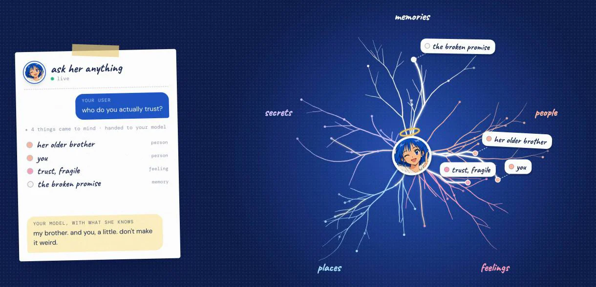
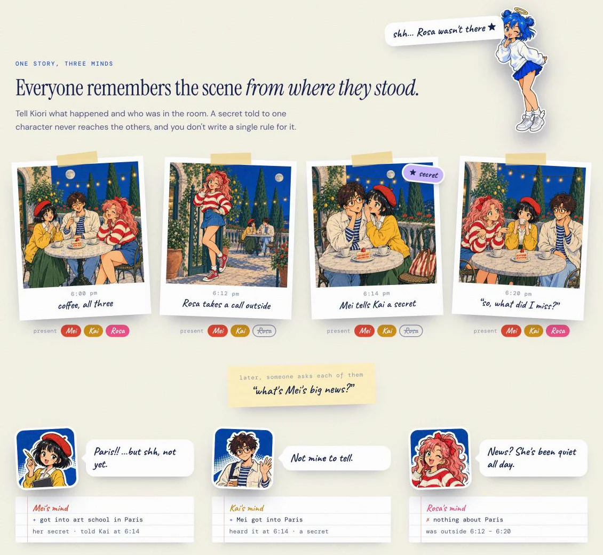

<div align="center">


# Kiori

**Give every character a mind of their own.**

What they remember, what they never saw, who they love, what they hide.<br>
Your app keeps the chat, the model and the brains. Kiori stores no brains and no chats.

[](https://github.com/kiori-ai/kiori/actions/workflows/test.yml)
[](https://github.com/kiori-ai/kiori/stargazers)
[](#-license)
[](https://github.com/kiori-ai/kiori/commits)
[](https://kiori.io)
[](https://kiori.io/docs)
[](docs/self-hosting.md)
[](package.json)

**English** | [简体中文](README.zh-CN.md)

</div>

---

## ⚡ What Kiori is

Not a chatbot: the mind behind yours. Your app does the talking and your model writes every line. Kiori is the part that remembers. It builds each character's brain, updates it as the story moves, and right before they speak, hands your model exactly what that character knows.

> **You give Kiori:** a character card (or a name and a paragraph), and the chat as it happens.
>
> **Kiori gives you back:** a brain you keep, what this character knows right now (ready to drop into your prompt), what they just learned, and, if you ask, whether a draft reply gives away something they never heard.

It works with any model, in any language. You bring your own model key (OpenRouter, OpenAI or Gemini) and pay your provider directly. The server has zero dependencies and about 3,600 lines of code, small enough to read in an afternoon.

## 🌸 Why "Kiori"

> **記 (ki)**: to record, to remember. **織 (ori)**: to weave.<br>
> Kiori is *the one who weaves memories*: she takes what happened, who was in the room and what was whispered, and weaves it into a mind that's only that character's. She's also our mascot: short bob, crooked halo, keeps your secrets.

<p align="center"></p>

## 📸 See it

**Inside one mind.** Memories, people, feelings, places and secrets, each on its own branch. When your user speaks, the right ones light up in a fraction of a second, and your model writes the reply with exactly that.

<p align="center"></p>

**One story, three minds.** Mei tells Kai a secret while Rosa is outside on a call. Later, ask each of them: only the ones who were there know.

<p align="center"></p>

Try it live at **[kiori.io](https://kiori.io)**.

## 🧠 What lives in a mind

| | |
|---|---|
| **Memories that fade** | They remember what they lived. Small things blur, big ones stay, and a night's sleep turns days into stories. |
| **Secrets that stay put** | Each mind knows only what it saw, heard or was told. A whisper stays with the people in the room. |
| **People they care about** | Trust, debts, crushes and grudges, person by person, updated as the story moves. |
| **An inner life** | Moods that carry over, habits, fears and beliefs: built from the 99% everyone shares, plus the 1% that's only theirs. |

Edits, rerolls and deleted messages are noticed and unlearned. A group chat works the same way: each character learns only the scenes they were in.

## 🔄 How it works

Three calls. That's the whole integration.

1. **Describe them** (`create`): send a character card, or a name and a paragraph. In about a minute Kiori builds a whole brain: a past, the people in it, an inner world. In a hurry? A light brain is instant and free.
2. **Tell it what happens** (`organize`): send the brain and the recent chat; the brain comes back wiser. Everyone learns only what they witnessed.
3. **Ask before they speak** (`recall`): get what your model needs in a fraction of a second. It's search, not generation, so it costs next to nothing. Optionally, `check` a draft for leaks before it's shown.

```js
let brain = await kiori.create({ character_card: card });                     // once per character: you keep it
const { text } = await kiori.recall({ brain, messages: chat.slice(-60) });     // before each reply: into your prompt
({ brain } = await kiori.organize({ brain, messages: chat.slice(-60) }));      // after it: it learns
```

## 🧭 Which way in?

| | **Kiori API** | **SillyTavern extension** | **The drop-in** | **Self-hosted** |
|---|---|---|---|---|
| **Best for** | Apps, games and platforms | Players | Apps already on an OpenAI-style API | Owning every part |
| **Setup** | A key from the console, 3 calls | Paste a URL, then your key | Change the base URL | One Node process, one SQLite file |
| **Who keeps the brains** | You (Kiori stores none) | Your chat files and cards | You | You |
| **Your model** | Any, on your key | Any SillyTavern supports | Any OpenAI-compatible one | Any |

## 🚀 Quick start

The SDKs are single files with no dependencies: [`sdk/kiori.mjs`](sdk/kiori.mjs) (JavaScript, Node 18+ and browsers) and [`sdk/kiori.py`](sdk/kiori.py) (Python 3.8+). Packages on npm (`kiori`) and PyPI (`kiori-ai`) are coming.

<details open>
<summary><b>JavaScript</b></summary>

```js
import { Kiori } from './kiori.mjs';
const kiori = new Kiori({ apiKey: process.env.KIORI_API_KEY });

let brain = await kiori.create({ character_card: card });
const { text } = await kiori.recall({ brain, messages: chat.slice(-60) });
const reply = await yourModel({ system: `${yourCharacterPrompt}\n\n${text}`, messages: chat });
chat.push({ role: 'assistant', content: reply });
({ brain } = await kiori.organize({ brain, messages: chat.slice(-60) }));
```
</details>

<details>
<summary><b>Python</b></summary>

```python
import os
from kiori import Kiori

kiori = Kiori(os.environ["KIORI_API_KEY"])
brain = kiori.create(character_card=card)
context = kiori.recall(brain=brain, messages=chat[-60:])
reply = your_model(system=your_character_prompt + "\n\n" + context["text"], messages=chat)
chat.append({"role": "assistant", "content": reply})
brain = kiori.organize(brain=brain, messages=chat[-60:])["brain"]
```
</details>

<details>
<summary><b>The drop-in (any OpenAI client)</b></summary>

```js
const ai = new OpenAI({ baseURL: 'https://api.kiori.io/v1', apiKey: process.env.KIORI_API_KEY });
const reply = await ai.chat.completions.create({ model: 'your/chat-model', messages, stream: true, kiori: { brain } });
```

Each character's mind goes into your system prompt and the request goes on to your model. Streaming works; nothing is kept.
</details>

<details>
<summary><b>SillyTavern</b></summary>

In SillyTavern, open **Extensions → Install extension** and paste `https://github.com/kiori-ai/SillyTavern-Kiori` (or unzip the extension from your console into `data/default-user/extensions`). Then paste your Kiori key in **Extensions → Kiori**. Each character gets a brain the first time you talk; it's kept in your chat files, on your computer.
</details>

<details>
<summary><b>Run your own Kiori</b></summary>

Node.js 22.13 or newer, nothing else to install:

```bash
git clone https://github.com/kiori-ai/kiori && cd kiori
echo "KIORI_LLM_KEY=sk-or-..." > .env          # your model key (OpenRouter by default)
node bin/kiori.mjs project create "My app"     # prints the project's Kiori key once, and a console sign-in link
node bin/kiori.mjs serve                       # API, console and docs on http://127.0.0.1:7700
```

Settings, the CLI and moving to a server: [docs/self-hosting.md](docs/self-hosting.md) and [deploy/](deploy/). Running your own is free for personal and non-commercial use; for a commercial product or service, see [License](#-license).
</details>

## 🔒 Private by design

- **Nothing to leak.** Kiori stores no brains and no chats. The brain is a JSON object that travels with each call and lives wherever you keep it.
- **Your model key stays sealed.** It's encrypted at rest (AES-256-GCM), only ever sent to the provider it was saved for, and never shown back whole.
- **Calls only go where they should.** Model calls go out over https to public addresses only; private networks and cloud metadata addresses are refused at connect time.
- **Read every line.** One process, zero dependencies, about 3,600 lines of server code. [docs/security.md](docs/security.md) has the details.

## 📚 Docs

| | |
|---|---|
| [Concepts](docs/concepts.md) | The brain file, presence, the organizer, the auditor, sleep |
| [Integration](docs/integration.md) | The calls, keeping brains, group chats, the drop-in, SillyTavern, errors |
| [API reference](docs/api.md) | Every endpoint, field and error code (also as [`/openapi.json`](https://kiori.io/openapi.json)) |
| [Security](docs/security.md) | What's stored, what isn't, and how keys are kept |
| [Self-hosting](docs/self-hosting.md) | Settings, commands, the server kit |

## 🗺️ Roadmap

- [x] Brains from character cards, learning from the chat, recall, the leak check
- [x] JavaScript and Python SDKs, the OpenAI-compatible drop-in, the SillyTavern extension
- [ ] npm and PyPI packages
- [ ] A public benchmark: who-knows-what in group chats, with and without Kiori
- [ ] Kiori's own small brain model, so learning costs a fraction of what it does today

## 🤝 Community

Kiori is in private beta: free while it lasts. [Ask for access](https://kiori.io/#access), open an [issue](https://github.com/kiori-ai/kiori/issues), or write to **help@kiori.io**. What you tell us shapes what we build.

## 📄 License

Free for personal and non-commercial use; licensed for commercial use.

- **Kiori itself** (everything here except `sdk/` and `sillytavern/`) is source-available under the [PolyForm Noncommercial License 1.0.0](LICENSE). Read it, run it, change it and share it for any non-commercial purpose: a personal project, study, research, a hobby, or a charity, school or public body.
- **Running it in a commercial product or service** needs a commercial license. Write to **help@kiori.io**.
- **The SDKs and the SillyTavern extension** are [MIT](sdk/LICENSE): use them anywhere, in commercial products too.
- **Calling hosted Kiori** (`api.kiori.io`) from your app, commercial or not, is using our service, and this license doesn't apply to it.

The name Kiori, the logo and the mascot artwork aren't covered by these licenses.

## 📈 Star history

[](https://star-history.com/#kiori-ai/kiori&Date)

<div align="center"><sub>if your characters talk, they deserve to remember ✦</sub></div>
